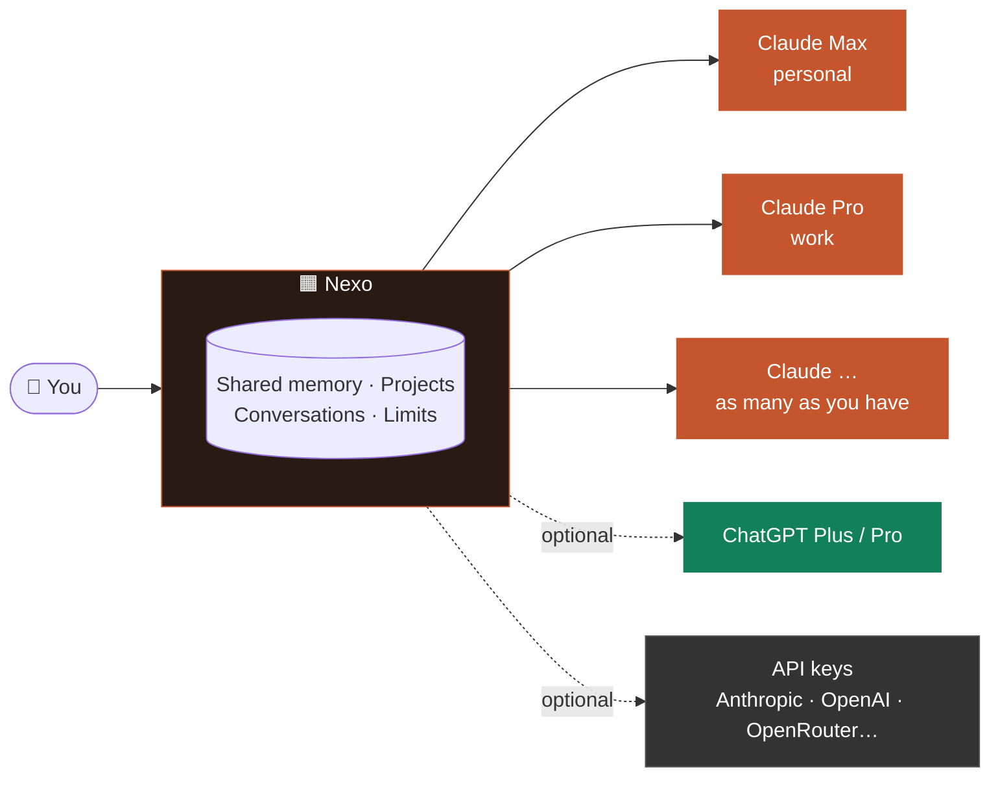
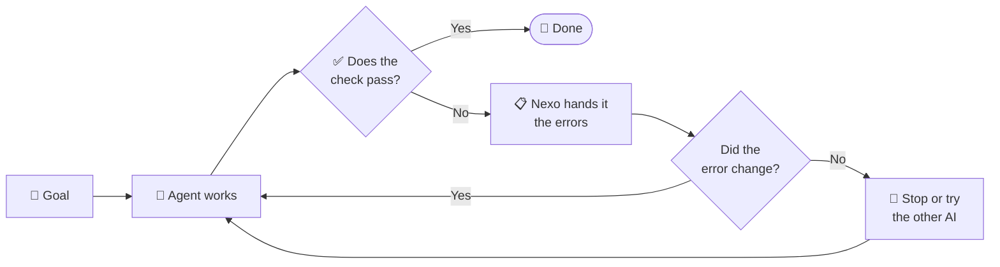

# Nexo

**All your Claude accounts in one desktop app.** 
Use more than one Claude Pro / Max subscription side by side — personal and work, or several plans — 
with shared memory, projects and conversations. When one account runs out, the next one picks up the chat.

[**⬇ Download for Windows**](https://github.com/CrushedDEV/nexo-releases/releases/latest) · [Multiple accounts](#-how-multiple-claude-accounts-work) · [What's new](#-whats-new-in-012) · [Features](#-features) · [Requirements](#-requirements) · [Support](#-feedback-and-support)

 

<picture>
  <source media="(prefers-color-scheme: light)" srcset="docs/img/chat-light.png">
  
</picture>

> [!NOTE]
> This repository hosts the Windows installers and the issue tracker. The source code is private.

 

## ✨ Why Nexo

<table>
<tr>
<td width="33%" valign="top">

### 🔀 Several Claude accounts, one chat
Add every Claude **Pro / Max** account you have — each signs in on its own profile. Switch account
mid-conversation and the next answer keeps **all the context**.

</td>
<td width="33%" valign="top">

### 🔋 Never stuck at the limit
The **5-hour and weekly limits** of every account, always in sight. **Automatic** picks the account
with the most room; if one runs out mid-task, **failover** carries on with the next.

</td>
<td width="33%" valign="top">

### 💳 Your plans, not credit
Nexo talks to your plans through Claude Code, so it only spends your **plan's limits** and
**never** paid extra usage or API credit.

</td>
</tr>
</table>

> **ChatGPT too, if you have it.** A ChatGPT Plus / Pro plan (through Codex) is just one more account
> in Nexo: ask it for a **second opinion** on Claude's answer, **compare** both, or let it take over
> when your Claude accounts are all resting. Optional — Nexo is built around Claude.

 

## 🔀 How multiple Claude accounts work

1. **Your first account** uses the Claude Code session you already have on this computer.
2. **Add more** in **Accounts → New account → Claude → Another account**: Nexo creates a
   separate profile and opens a window to sign in with that account. Add as many as you have.
3. **Pick one per conversation**, or choose **Automatic** and Nexo uses the one with the most room
   left on every message.

Then Nexo keeps an eye on all of them for you:

- **Limits at a glance**: the 5-hour session and weekly usage of each account, a forecast of when
  you'll run out at your pace, and warnings at 80 % and 95 %.
- **Failover**: if an account hits its limit or fails, another one answers automatically — with the
  whole conversation, memory and project.
- **Wait for the reset**: if every account is resting, leave the message and it sends itself when a
  limit resets.
- **Never extra usage**: if Claude Code would switch to paid extra usage, Nexo stops and the next
  account carries on.
- **Ask another account**: compare up to 4 accounts on the same question, or let a model consult
  another of your accounts in the middle of a task.

 

## 📥 Download

1. Download `Nexo-Setup-x.y.z.exe` from the [latest release](https://github.com/CrushedDEV/nexo-releases/releases/latest).
2. Run it. The installer is not code-signed yet: if Windows SmartScreen shows a warning, click
   **More info → Run anyway**.

> [!TIP]
> Once installed, **Nexo updates itself**: new versions download in the background and install with
> one click. Afterwards, a "What's new" window shows what changed.

 

## 🎉 What's new in 0.12

- **Nexo on your phone**: an Android app and an iPhone web app connected to your PC from any network,
  end-to-end encrypted, with notifications when a reply finishes.
- **Share a chat**: an encrypted link anyone can read; if they have Nexo, they save it and continue
  it with their own accounts.
- Long conversations now summarize reliably, however big they get.

Since 0.11: loop mode, a parallel task board, project rules, GitHub, one-click diagnostics, PIN lock,
private chats, a knowledge base, a side document, voice mode and more.

 

## 🧭 Features

<table>
<tr>
<td width="50%" valign="top">

### ⚖️ Compare your accounts

Ask up to **4 accounts at once** — two Claude plans, or Claude and ChatGPT — and pick the answer
the conversation continues with. Shown here with the animated *Night* theme.

</td>
<td width="50%" valign="top">

### 💻 Code: an agent in your folder

It edits files and runs commands, with **Changes**, a real Windows **Terminal**, and your
**check** (say `npm test`) under every reply.

</td>
</tr>
<tr>
<td width="50%" valign="top">

### 🔁 Loop mode

A goal plus a command that checks it's done. The agent keeps going **until it passes**; if it gets
stuck, it stops or hands over to another account.

</td>
<td width="50%" valign="top">

### 📋 Parallel task board

Several tasks at once, **each on its own isolated branch**. When they finish: merge, open a PR or
discard in one click.

</td>
</tr>
<tr>
<td width="50%" valign="top">

### 🪟 Split view

Drag chats from the sidebar and drop them anywhere: columns, rows or a grid, each one answering on
its own.

</td>
<td width="50%" valign="top">

### 🌅 Animated chat themes

Type `/theme` and pick a living ASCII wallpaper (sunset, night, rain, aurora…) or **describe the
mood** and the AI designs it.

</td>
</tr>
<tr>
<td width="50%" valign="top">

### 🏠 Home and templates

"Pick up where you left off", templates with blanks (`{{text}}`) and your 5-hour and weekly
limits always in sight.

</td>
<td width="50%" valign="top">

### ⚙️ Full settings

English or Spanish, appearance, code themes, notifications, PIN, Windows context menu, a floating
mini window on Alt + Space…

</td>
</tr>
</table>

### And also

| | | |
|:---|:---|:---|
| 📱 **Nexo on your phone**: Android app and iPhone web app | 🔗 **Share a chat** with an encrypted link | 🤝 **Second opinion** from another account or ChatGPT |
| 🔒 **PIN lock** and private chats | 🗝️ **Secret warning** before you send a key | 🩺 **One-click diagnostics** and error report |
| 📄 **Side document** the AI edits piece by piece | 📚 **Knowledge base** per project | 📓 **Work journal** for your day or week |
| 🐙 **GitHub**: issues, PRs and "Fix on a branch" | 🖱️ **Windows context menu** | 🎙️ **Voice mode** and read aloud |
| ⏰ **Scheduled prompts** that send themselves | 💾 **Automatic backups** to OneDrive or Drive | 🧾 **Export** to Markdown, web page or PDF |
| ↩️ **Undo** what the agent did | 🌿 **Isolated branches** (git worktree) | 🔔 **Windows notifications** when a reply finishes |
| 📥 **Import** your Claude and ChatGPT chats | 🧩 **MCP connectors** and **skills**, shared | 📊 **Stats**, streaks and "You've saved" |

 

## 🔁 How loop mode works

 

## 🧾 Requirements

| | To use… | You need |
|---|---|---|
|  | one or more **Pro / Max** plans | [Claude Code](https://claude.com/download), signed in with your Claude account (Nexo opens the sign-in for each extra account) |
|  | *optional* — a **Plus / Pro** plan | [Codex](https://github.com/openai/codex) (`npm i -g @openai/codex`), signed in with ChatGPT |
| 🔑 | *optional* — an **API key** | A key from Anthropic, OpenAI or any OpenAI-compatible service |

Plus **Windows 10 or 11 (64-bit)**. Nexo's first-run guide walks you through all of this.

> [!IMPORTANT]
> Nexo never spends API credit on your behalf when you use a subscription: if a tool is signed in
> with an API key instead of your plan, Nexo refuses to send and tells you how to fix it. Nexo is for
> **your own accounts** on your own computer — subscriptions can't be shared or resold.

 

## 💬 Feedback and support

<table>
<tr>
<td align="center" width="33%">

🐞 
**Found a bug?** 
[Open a bug report](https://github.com/CrushedDEV/nexo-releases/issues/new?template=bug_report.yml)

</td>
<td align="center" width="33%">

💡 
**Have an idea?** 
[Request a feature](https://github.com/CrushedDEV/nexo-releases/issues/new?template=feature_request.yml)

</td>
<td align="center" width="33%">

🛡️ 
**Security issue?** 
Please don't open a public issue — see [SECURITY.md](SECURITY.md)

</td>
</tr>
</table>

> [!TIP]
> In Nexo, **Settings → About Nexo → Diagnostics** checks everything and can create an error report
> without keys or conversations — attach it to your bug report.

See also [CONTRIBUTING.md](CONTRIBUTING.md), [CODE_OF_CONDUCT.md](CODE_OF_CONDUCT.md) and
[ACCESSIBILITY.md](ACCESSIBILITY.md).

---

 
Nexo is an independent project. It is not affiliated with or endorsed by Anthropic or OpenAI. Claude and ChatGPT are trademarks of their respective owners.

