

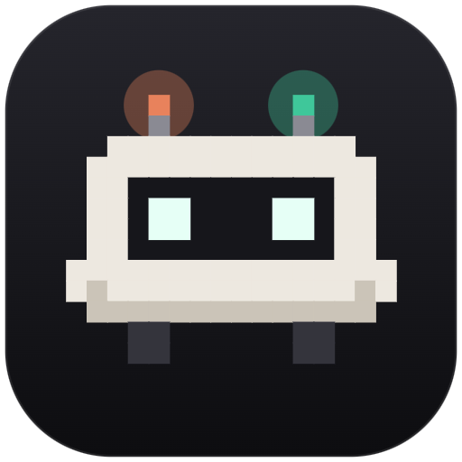

# Nexo

**Claude and ChatGPT in one desktop app.** 
Your subscriptions and API accounts share memory, projects and conversations: 
switch AI mid-conversation and the next answer keeps all the context.

[**⬇ Download for Windows**](https://github.com/CrushedDEV/nexo-releases/releases/latest) · [What's new](#-whats-new-in-011) · [Features](#-features) · [Requirements](#-requirements) · [Support](#-feedback-and-support)

 

<picture>
  <source media="(prefers-color-scheme: light)" srcset="docs/img/chat-light.png">
  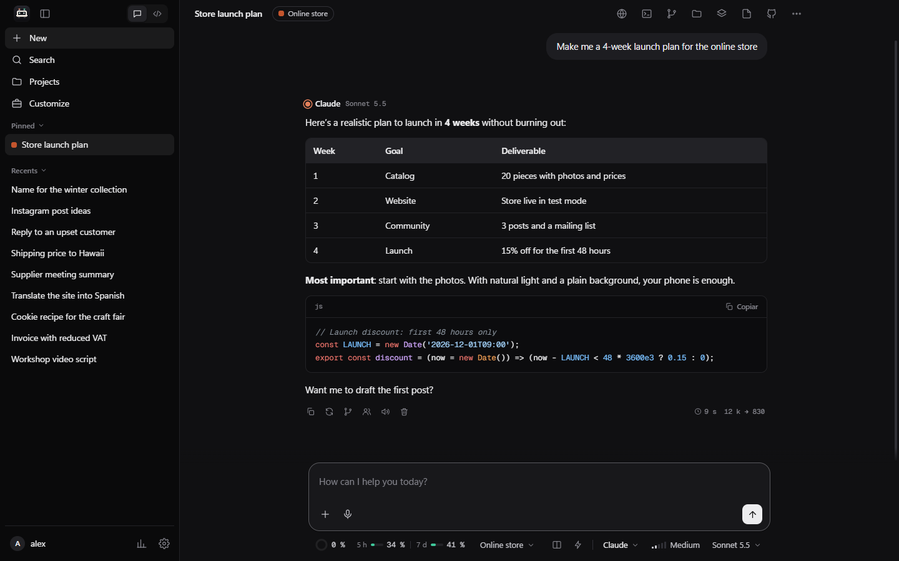
</picture>

> [!NOTE]
> This repository hosts the Windows installers and the issue tracker. The source code is private.

 

## ✨ Why Nexo

<table>
<tr>
<td width="33%" valign="top">

### 🤝 Two AIs, one chat
Claude and ChatGPT read the same conversation, memory and projects. Ask the other AI for a
**second opinion** in one click, or **compare** their answers side by side.

</td>
<td width="33%" valign="top">

### 💳 Your plans, not credit
Use your **Pro / Max** and **Plus / Pro** subscriptions through Claude Code and Codex. Nexo only
spends your plan's limits and **never** paid extra usage.

</td>
<td width="33%" valign="top">

### 🤖 Agents that work on their own
**Loop mode**, a parallel **task board** with isolated branches, project rules and GitHub built
in. You review and merge.

</td>
</tr>
</table>

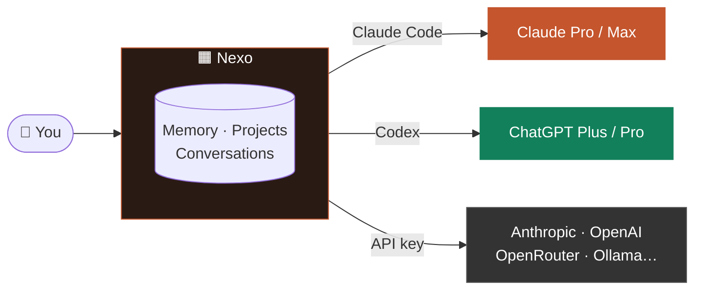

 

## 📥 Download

1. Download `Nexo-Setup-x.y.z.exe` from the [latest release](https://github.com/CrushedDEV/nexo-releases/releases/latest).
2. Run it. The installer is not code-signed yet: if Windows SmartScreen shows a warning, click
   **More info → Run anyway**.

> [!TIP]
> Once installed, **Nexo updates itself**: new versions download in the background and install with
> one click. Afterwards, a "What's new" window shows what changed.

 

## 🎉 What's new in 0.11

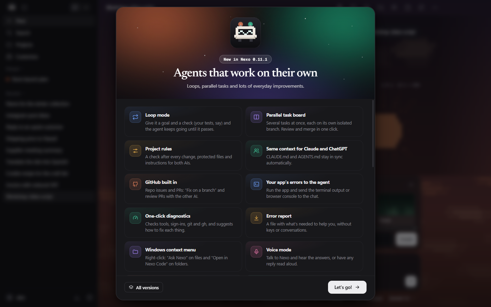

**17 new features**: loop mode, a parallel task board, project rules, GitHub, one-click diagnostics,
PIN lock, private chats, a knowledge base, a side document, voice mode and more.

 

## 🧭 Features

<table>
<tr>
<td width="50%" valign="top">

### ⚖️ Compare Claude and ChatGPT
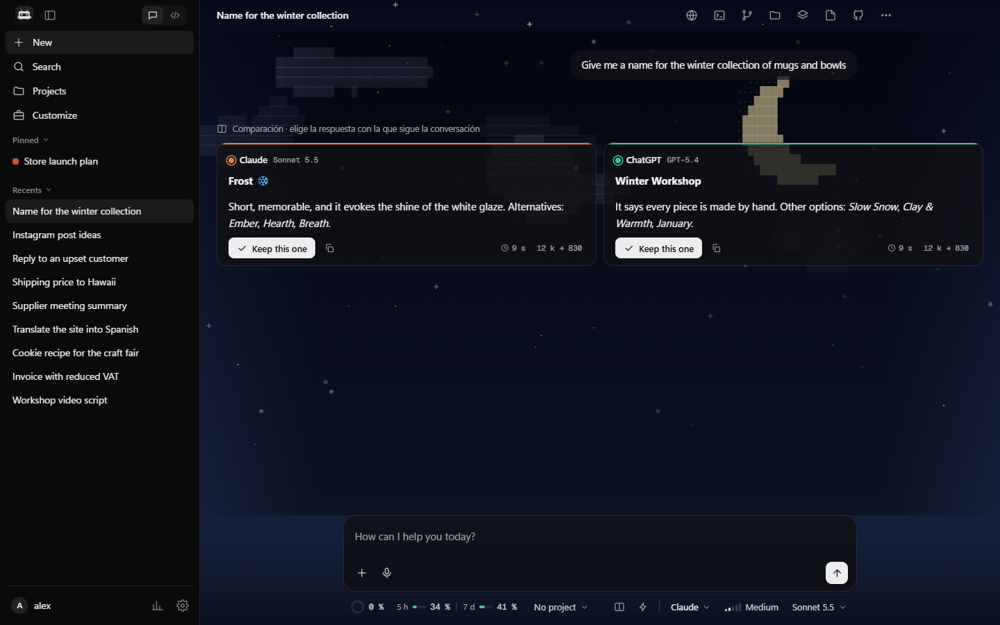

Ask up to **4 accounts at once** and pick the answer the conversation continues with. Shown here
with the animated *Night* theme.

</td>
<td width="50%" valign="top">

### 💻 Code: an agent in your folder
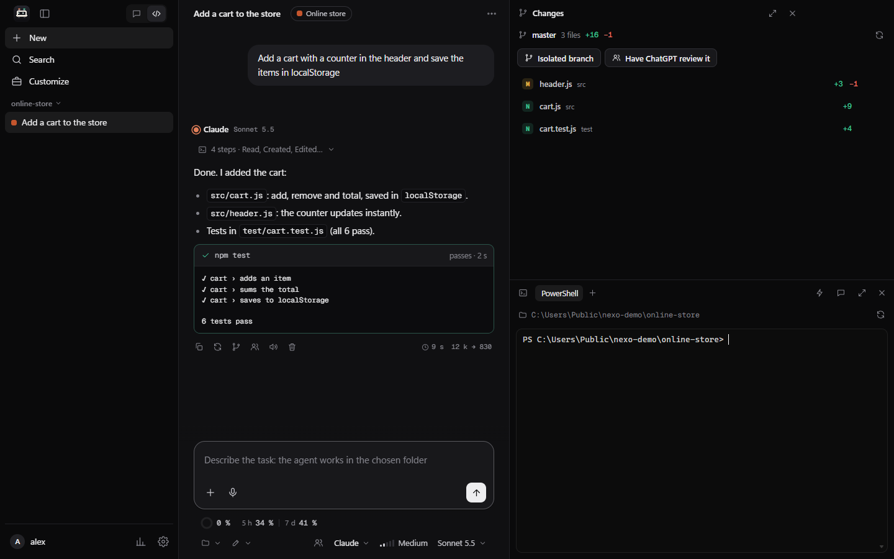

It edits files and runs commands, with **Changes**, a real Windows **Terminal**, and your
**check** (say `npm test`) under every reply.

</td>
</tr>
<tr>
<td width="50%" valign="top">

### 🔁 Loop mode
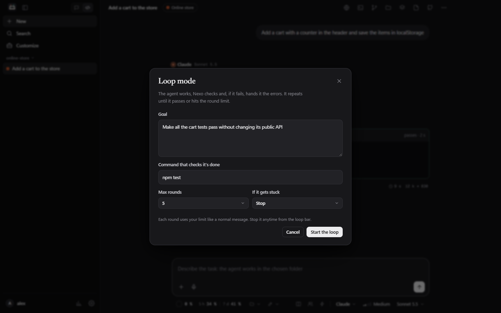

A goal plus a command that checks it's done. The agent keeps going **until it passes**; if it gets
stuck, it stops or hands over to the other AI.

</td>
<td width="50%" valign="top">

### 📋 Parallel task board
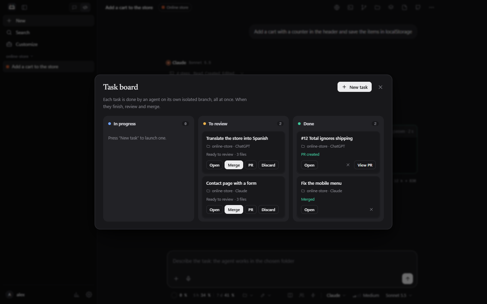

Several tasks at once, **each on its own isolated branch**. When they finish: merge, open a PR or
discard in one click.

</td>
</tr>
<tr>
<td width="50%" valign="top">

### 🪟 Split view
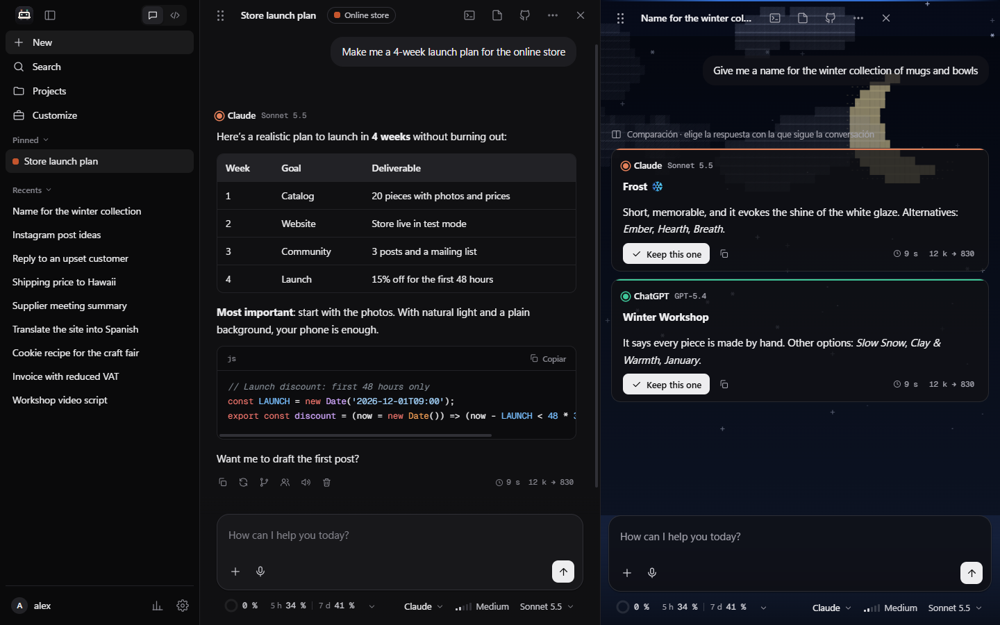

Drag chats from the sidebar and drop them anywhere: columns, rows or a grid, each one answering on
its own.

</td>
<td width="50%" valign="top">

### 🌅 Animated chat themes
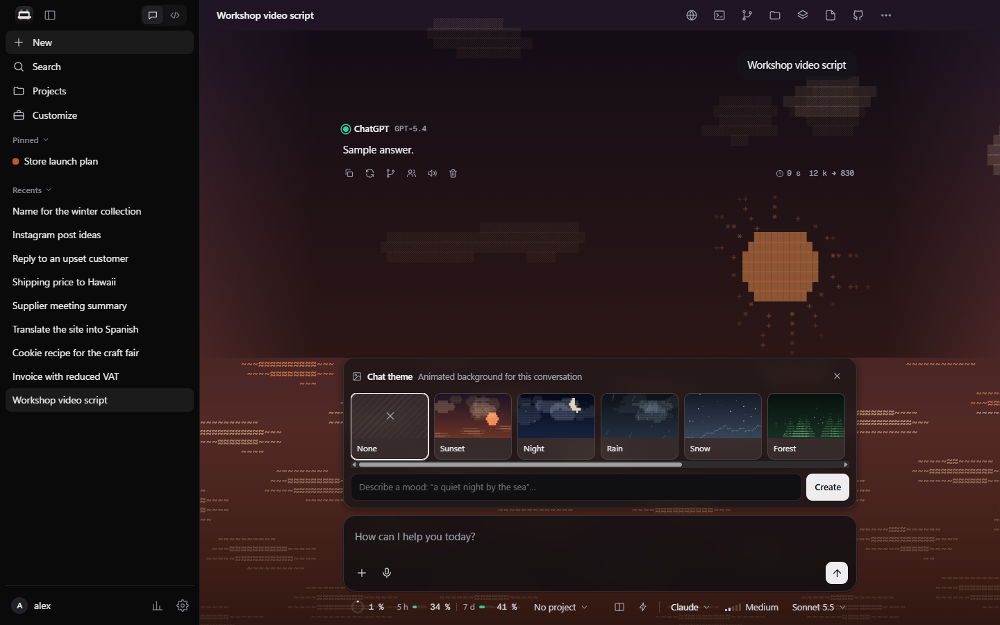

Type `/theme` and pick a living ASCII wallpaper (sunset, night, rain, aurora…) or **describe the
mood** and the AI designs it.

</td>
</tr>
<tr>
<td width="50%" valign="top">

### 🏠 Home and templates
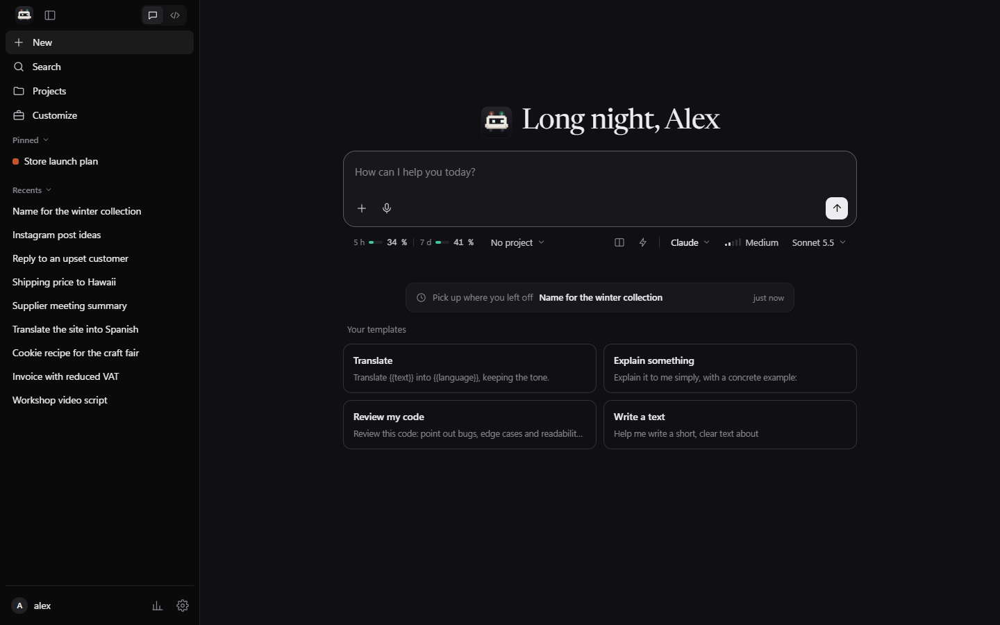

"Pick up where you left off", templates with blanks (`{{text}}`) and your 5-hour and weekly
limits always in sight.

</td>
<td width="50%" valign="top">

### ⚙️ Full settings
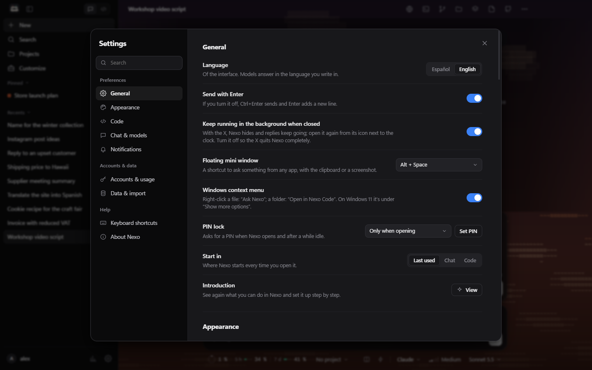

English or Spanish, appearance, code themes, notifications, PIN, Windows context menu, a floating
mini window on Alt + Space…

</td>
</tr>
</table>

### And also

| | | |
|:---|:---|:---|
| 🔒 **PIN lock** and private chats | 🗝️ **Secret warning** before you send a key | 🩺 **One-click diagnostics** and error report |
| 📄 **Side document** the AI edits piece by piece | 📚 **Knowledge base** per project | 📓 **Work journal** for your day or week |
| 🐙 **GitHub**: issues, PRs and "Fix on a branch" | 🖱️ **Windows context menu** | 🎙️ **Voice mode** and read aloud |
| ⏰ **Scheduled prompts** that send themselves | 💾 **Automatic backups** to OneDrive or Drive | 🧾 **Export** to Markdown, web page or PDF |
| ↩️ **Undo** what the agent did | 🌿 **Isolated branches** (git worktree) | 🔔 **Windows notifications** when a reply finishes |
| 📥 **Import** your Claude and ChatGPT chats | 🧩 **MCP connectors** and **skills**, shared | 📊 **Stats**, streaks and "You've saved" |

 

## 🔁 How loop mode works

 

## 🧾 Requirements

| | To use… | You need |
|---|---|---|
|  | a **Pro / Max** plan | [Claude Code](https://claude.com/download), signed in with your Claude account |
|  | a **Plus / Pro** plan | [Codex](https://github.com/openai/codex) (`npm i -g @openai/codex`), signed in with ChatGPT |
| 🔑 | an **API key** | A key from Anthropic, OpenAI or any OpenAI-compatible service |

Plus **Windows 10 or 11 (64-bit)**. Nexo's first-run guide walks you through all of this.

> [!IMPORTANT]
> Nexo never spends API credit on your behalf when you use a subscription: if a tool is signed in
> with an API key instead of your plan, Nexo refuses to send and tells you how to fix it. Each person
> uses their own accounts on their own computer — subscriptions can't be shared or resold.

 

## 💬 Feedback and support

<table>
<tr>
<td align="center" width="33%">

🐞 
**Found a bug?** 
[Open a bug report](https://github.com/CrushedDEV/nexo-releases/issues/new?template=bug_report.yml)

</td>
<td align="center" width="33%">

💡 
**Have an idea?** 
[Request a feature](https://github.com/CrushedDEV/nexo-releases/issues/new?template=feature_request.yml)

</td>
<td align="center" width="33%">

🛡️ 
**Security issue?** 
Please don't open a public issue — see [SECURITY.md](SECURITY.md)

</td>
</tr>
</table>

> [!TIP]
> In Nexo, **Settings → About Nexo → Diagnostics** checks everything and can create an error report
> without keys or conversations — attach it to your bug report.

See also [CONTRIBUTING.md](CONTRIBUTING.md), [CODE_OF_CONDUCT.md](CODE_OF_CONDUCT.md) and
[ACCESSIBILITY.md](ACCESSIBILITY.md).

---

 
Nexo is an independent project. It is not affiliated with or endorsed by Anthropic or OpenAI. Claude and ChatGPT are trademarks of their respective owners.

